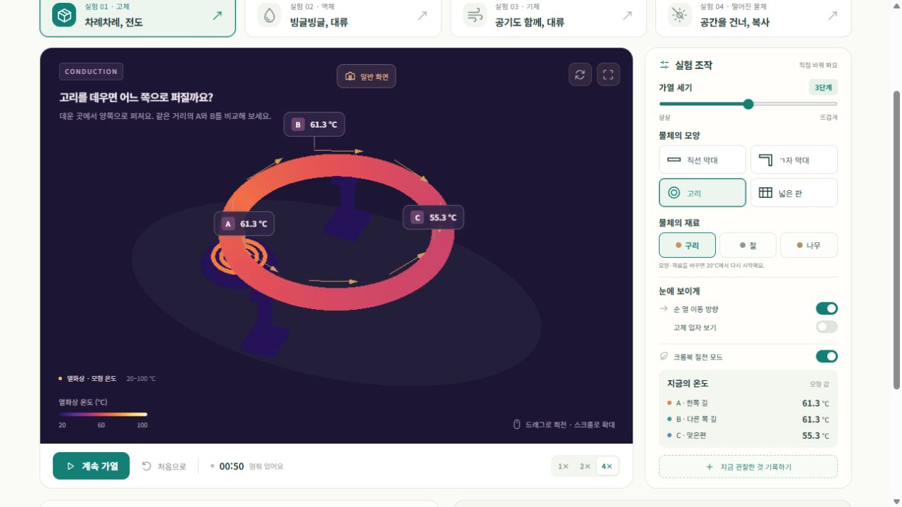
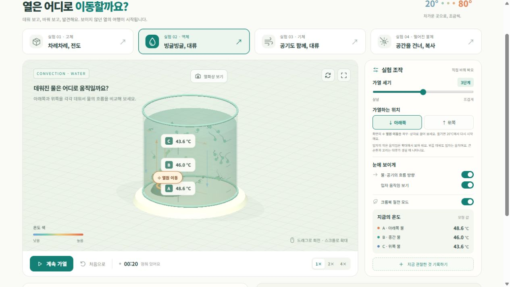

# 온기 실험실 · 열의 이동 3D

초등학교 5학년 과학의 **전도·대류·복사**를 직접 조작하며 살펴보는 한국어 3D 웹 실험실입니다. 재료와 열원의 위치를 바꾸고, 온도 색과 입자의 움직임을 관찰한 뒤 탐구 노트로 기록할 수 있습니다.

HTML·CSS·JavaScript와 Three.js로 구성했으며, 별도의 빌드나 npm 패키지 설치 없이 실행합니다. 배포된 사이트는 브라우저에서 바로 이용할 수 있습니다.

> 화면의 온도와 시간은 원리를 설명하는 교육용 모형 값입니다. 실제 측정이나 정밀한 열·유체 해석을 대신하지 않습니다.

## 화면 예시

**고리에서 양쪽으로 퍼지는 전도와 열화상 온도 표시**



**물의 대류, 구슬 입자의 움직임과 열원 이동**



기존 프로젝트에서 촬영한 예시 화면입니다. 표시된 수치는 실험 조건과 진행 시간에 따라 달라집니다.

## 주요 기능

| 실험 | 바꿀 수 있는 조건 | 관찰할 내용 |
| --- | --- | --- |
| 고체의 전도 | 직선 막대·ㄱ자 막대·고리·넓은 판, 구리·철·나무 | 연결된 재료를 따라 퍼지는 열, A·B·C 온도 |
| 액체의 대류 | 물의 아래·위 가열, 열원의 좌우·상하 위치 | 따뜻한 물의 상승과 주변 물의 하강, 위 가열과의 차이 |
| 기체의 대류 | 공기의 아래·위 가열, 열원의 좌우·상하 위치 | 난방 위치에 따른 큰 순환과 입자의 작은 운동 |
| 복사 | 거리 1–4칸, 검고 무광·반짝이는 금속 표면, 반사 가림판 | 거리·흡수율에 따른 가열 차이, 가림판을 넣은 뒤 냉각 |

- 가열 세기 1–5단계, 1·2·4배속, 일시정지와 초기화
- 드래그로 시점 회전, 스크롤로 확대, 전체 화면
- 20–100°C의 고정 눈금을 사용하는 열화상 보기
- 물·공기 열원을 드래그하거나, 이동 손잡이에 초점을 둔 뒤 방향키로 조작
- 예상 질문과 관찰 포인트, 생활 속 사례
- 탐구 노트의 브라우저 저장 및 UTF-8 텍스트 다운로드
- 기본 크롬북 절전 모드, 탭을 벗어날 때 자동 일시정지

## 빠른 시작

로컬 실행에는 **Node.js 24.x와 npm**, 실험 화면에는 **WebGL2를 지원하는 Chrome 또는 Edge**를 사용하세요.

이 README와 `package.json`이 있는 폴더에서 실행합니다.

```sh
npm start
```

브라우저에서 [http://127.0.0.1:4188](http://127.0.0.1:4188)을 엽니다. 서버를 종료하려면 터미널에서 `Ctrl+C`를 누르세요. npm 의존성이 없으므로 `npm install`은 필요하지 않습니다.

다른 포트를 쓰려면 Windows PowerShell에서 다음과 같이 실행합니다.

```powershell
$env:PORT = '8080'
npm start
```

macOS·Linux에서는 `PORT=8080 npm start`를 사용합니다. `dist/index.html`을 파일로 직접 열면 ES 모듈이 제한될 수 있으므로 HTTP 서버로 실행하세요.

## 처음 실험하기

1. 상단에서 전도·액체 대류·기체 대류·복사 중 하나를 고릅니다.
2. 실험 조건을 정하고 **가열 시작**을 누릅니다.
3. 온도·색·화살표·입자를 관찰하고 **열화상 보기**로 비교합니다.
4. **지금 관찰한 것 기록하기**를 눌러 관찰 내용을 적습니다.
5. **탐구 노트 → 노트 내려받기**로 결과를 보관합니다.

공정하게 비교하려면 한 번에 한 조건만 바꾸고, 같은 실험 경과 시간에 기록하세요.

## 문서

| 문서 | 내용 |
| --- | --- |
| [사용 안내](docs/USER_GUIDE.md) | 화면 조작, 조건 변경과 초기화, 탐구 노트, 문제 해결 |
| [수업 활용 안내](docs/TEACHER_GUIDE.md) | 40분 수업 예시, 탐구 질문, 학생 기록 양식 |
| [물리 모형과 한계](docs/PHYSICS_MODEL.md) | 계산 방식, 온도 시각화, 해석 시 주의점 |
| [개발 안내](docs/DEVELOPMENT.md) | 파일 구조, 실행·테스트, 수정과 검증 방법 |
| [배포 안내](docs/DEPLOYMENT.md) | 정적 배포, GitHub Pages 설정과 실행 |
| [GitHub 업로드 안내](docs/GITHUB_UPLOAD.md) | 업로드할 위치, 숨김 파일, 웹·Git 업로드 절차 |
| [검증 기록](docs/VALIDATION.md) | 업로드 폴더에서 수행한 검사와 결과 |
| [외부 라이브러리 고지](THIRD_PARTY_NOTICES.md) | Three.js 버전과 MIT 라이선스 원문 |

## 프로젝트 구조

```text
.
├── README.md
├── package.json
├── server.mjs                  # dist/를 제공하는 로컬 HTTP 서버
├── dist/                       # 실제 실행·수정·배포 파일
│   ├── index.html
│   ├── style.css
│   ├── app.js                  # 3D 화면, 조작, 탐구 노트
│   ├── physics.js              # 열 이동 모형
│   ├── conduction.js           # 고체 모양과 전도 연결
│   ├── temperature-field.js    # 물·공기 온도장과 입자 위치
│   ├── temperature-material.js # 온도 셰이더
│   ├── flow-tracers.js         # 대류 입자와 꼬리
│   └── vendor/                # Three.js, OrbitControls, 라이선스
├── tests/physics.test.mjs
├── docs/                       # 안내 문서와 화면 예시
├── .github/workflows/          # 자동 테스트, 수동 Pages 배포
├── .gitignore
├── .gitattributes
└── THIRD_PARTY_NOTICES.md
```

`dist/`는 이 프로젝트에서 편집하는 원본 코드이자 배포 파일입니다. GitHub에 반드시 포함하세요. 별도 `src/` 폴더나 빌드 명령은 없습니다.

## 테스트

```sh
npm test
```

Node.js 기본 테스트 러너로 전도 경로, 재료 비교, 대류, 복사, 온도장과 온도계의 일치, 초기화와 배속 등을 검사합니다. 화면 렌더링과 실제 기기 성능은 별도로 확인해야 합니다.

## 배포

정적 호스팅의 게시 디렉터리를 **`dist/`**로 지정하세요. 서버 측 처리나 외부 API 키가 필요하지 않습니다. GitHub에는 이 폴더의 내용 전체를 저장하고, 웹사이트에는 `dist/`의 내용을 게시합니다.

GitHub Pages용 수동 배포 워크플로도 포함되어 있습니다. 저장소의 Pages 게시 소스를 GitHub Actions로 설정한 뒤 실행하는 방법은 [배포 안내](docs/DEPLOYMENT.md)를 참고하세요.

## 저장과 실행 환경

탐구 노트는 현재 브라우저의 `localStorage`에 최대 100개 저장됩니다. 앱에는 계정·서버 저장·기기 간 동기화 기능이 없습니다. 같은 기기를 사용해도 주소·포트·브라우저가 달라지면 기존 기록이 보이지 않을 수 있으므로 수업 후 텍스트로 내려받으세요.

Three.js는 프로젝트 안에서 제공하며, 앱에 외부 폰트 다운로드·분석 스크립트·외부 API 호출은 포함되어 있지 않습니다. 학교 기기의 WebGL 허용 여부와 실제 ChromeOS 성능은 사용 환경에서 확인해야 합니다.

## 라이선스

Three.js 0.170.0과 OrbitControls의 MIT 라이선스 원문은 [dist/vendor/THREE-LICENSE.txt](dist/vendor/THREE-LICENSE.txt)에 보존되어 있습니다.

이 패키지에는 프로젝트 자체의 별도 라이선스가 지정되어 있지 않습니다. 프로젝트 코드·문서·이미지의 재사용 조건을 명시하려면 소유자가 적절한 라이선스를 선택해 `LICENSE` 파일을 추가하세요. 상세 구분은 [외부 라이브러리 고지](THIRD_PARTY_NOTICES.md)에 있습니다.
